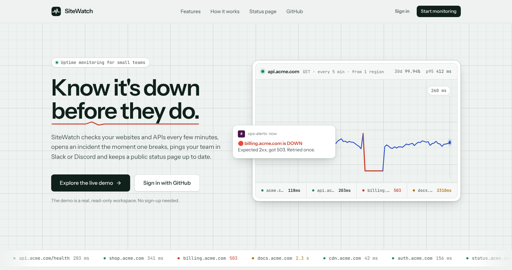
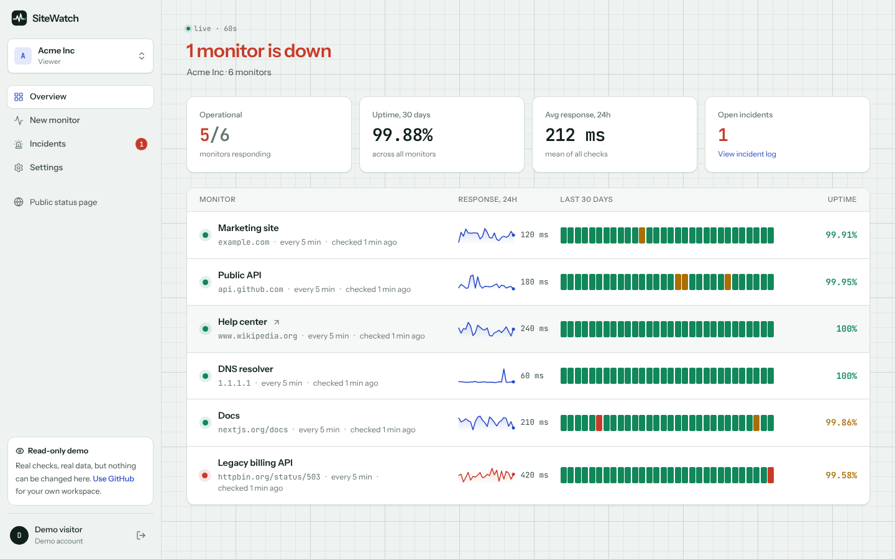
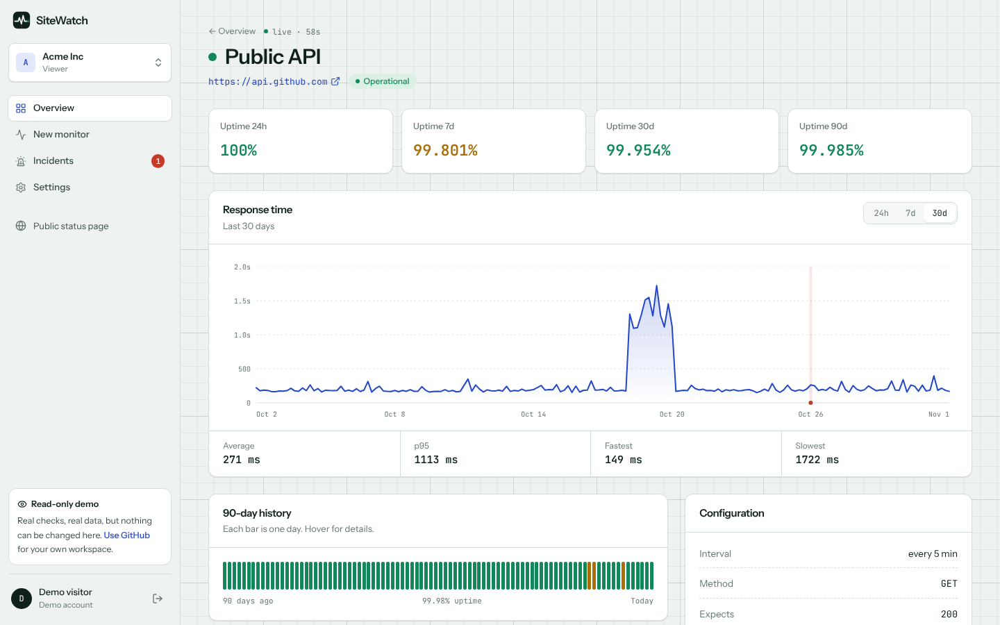
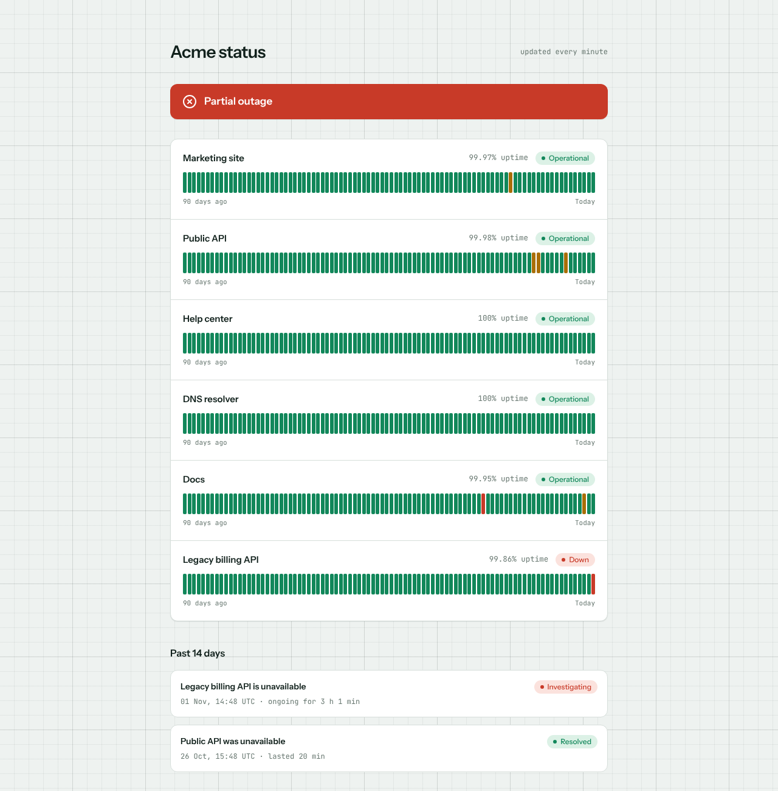
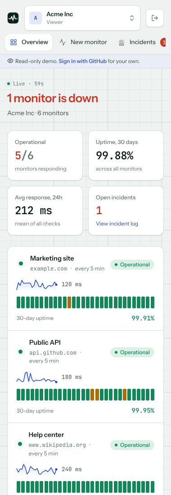

# SiteWatch

Uptime monitoring for small teams. SiteWatch checks websites and APIs on a schedule, opens an incident when one fails, posts to Slack or Discord, and publishes a public status page.



**Live demo:** _add your Vercel URL here after deploying_ · read-only demo login, no account needed.

## Features

- **HTTP checks** every 5, 10, 15, 30 or 60 minutes with configurable timeout, expected status code, a keyword that must appear in the body, and a "slow" threshold that marks a monitor as degraded.
- **Retry before alerting.** A failed check is retried once after 1.5 s. Only two failures in a row count as down.
- **Incidents** open and resolve automatically. A partial unique index in Postgres guarantees at most one open incident per monitor.
- **Slack / Discord webhooks** for incident opened and resolved, plus a "send test" button.
- **SSL certificate expiry** read via a TLS handshake, refreshed twice a day.
- **Workspaces and roles** (owner, admin, member, viewer) with single-use invite links that expire after 7 days.
- **Public status page** per workspace with 90-day uptime bars and recent incidents. It never exposes URLs, keywords or error messages.
- **Dashboard** with live refresh, 24h/7d/30d response-time charts (hand-built SVG), p95, and per-day uptime history.
- **Read-only demo account** so visitors can explore without signing up.

| Overview | Monitor detail |
| --- | --- |
|  |  |

| Public status page | Mobile |
| --- | --- |
|  |  |

## Tech stack

- **Next.js 16** (App Router, Server Components, Server Actions), **React 19**, **TypeScript** strict
- **Tailwind CSS v4** with a small token-based design system, **Motion** for landing page animation
- **Postgres** (Neon in production) with **Drizzle ORM** and SQL migrations
- **Auth.js v5** with GitHub OAuth and JWT sessions
- **Vitest** for unit tests, GitHub Actions for CI and for the 5-minute scheduler

## Architecture notes

```
GitHub Actions (every 5 min) ──► GET /api/cron/check (Bearer CRON_SECRET)
                                     │
                                     ▼
                     claim due monitors (FOR UPDATE SKIP LOCKED)
                                     │
                     run checks in parallel batches of 8
                                     │
           store check ─► update monitor ─► open/resolve incident ─► webhook
```

- **Scheduler.** Vercel's free plan only allows one cron run per day, so a GitHub Actions workflow calls the endpoint every 5 minutes (Vercel Cron stays as a daily safety net). Due monitors are claimed with `UPDATE … WHERE id IN (SELECT … FOR UPDATE SKIP LOCKED)`, so two overlapping runs never check the same monitor twice. This was verified locally by firing two runs at once against 10 due monitors: exactly 10 checks were written.
- **Tenant isolation.** Every page and Server Action goes through `src/lib/dal.ts`. `requireWorkspace(slug)` joins on the membership table, so a non-member gets a 404 rather than a 403 and can't even confirm a workspace exists. Monitor routes load monitors only by `(id, workspaceId)`.
- **Permissions.** A single role matrix in `src/lib/permissions.ts`. Server Actions re-check the role on every call; hiding buttons in the UI is only cosmetic.
- **SSRF protection.** Monitors fetch user-supplied URLs from the server, which is a classic SSRF vector. `src/lib/monitoring/url-guard.ts` rejects non-http schemes, embedded credentials, and any host that resolves to loopback, private, link-local (including `169.254.169.254` cloud metadata), CGNAT or multicast ranges. Redirects are followed manually so every hop is checked. Known limitation: DNS rebinding between the check and the connection is not fully prevented.
- **Aggregations in SQL.** Uptime percentages, daily buckets and chart series use `date_trunc` / `date_bin` and `count(*) filter (…)`, so pages never load thousands of raw rows.
- **Data retention.** Checks older than 90 days are deleted at the end of each scheduler run.

## Running locally

Requirements: Node.js 20.12+ and a Postgres database (local, Docker, or a free Neon project).

```bash
npm install
cp .env.example .env.local      # then fill in the values
npm run db:migrate              # create tables
npm run db:seed                 # optional: demo workspace at /app/demo and /status/demo
npm run dev
```

Trigger the scheduler manually while `npm run dev` is running:

```bash
npm run checks
```

To monitor `localhost` services during development, set `ALLOW_PRIVATE_TARGETS=1`. It is ignored in production.

### Scripts

| Command | What it does |
| --- | --- |
| `npm run dev` | Start the dev server |
| `npm run build` | Production build |
| `npm test` | Unit tests (checker, SSRF guard, permissions, helpers) |
| `npm run typecheck` / `npm run lint` | Static checks |
| `npm run db:generate` | Create a migration after changing `src/db/schema.ts` |
| `npm run db:migrate` | Apply migrations |
| `npm run db:seed` | Recreate the demo workspace |
| `npm run checks` | Call the scheduler endpoint once |

## Deploying to Vercel

1. **Database.** Create a project on [Neon](https://neon.tech) and copy the **pooled** connection string.
2. **GitHub OAuth app.** GitHub → Settings → Developer settings → OAuth Apps → New. Homepage: your Vercel URL. Callback: `https://YOUR-DOMAIN/api/auth/callback/github`.
3. **Vercel project.** Import the repository and add the environment variables from `.env.example` (`DATABASE_URL`, `AUTH_SECRET`, `AUTH_GITHUB_ID`, `AUTH_GITHUB_SECRET`, `CRON_SECRET`, `APP_URL`). The `vercel-build` script runs migrations before building.
4. **Demo data.** Run `npm run db:seed` once from your machine with `DATABASE_URL` pointing at Neon.
5. **Scheduler.** In the GitHub repository → Settings → Secrets and variables → Actions, add `APP_URL` and `CRON_SECRET`. The `Run monitor checks` workflow starts calling the endpoint every 5 minutes. GitHub may delay scheduled workflows by a few minutes under load.

## Honest limitations

- Checks run from a single region (wherever the Vercel function runs), so a regional network issue can look like an outage.
- The demo workspace's first 90 days of history are generated by the seed script so the charts aren't empty. Everything after deployment comes from real checks.
- Notifications are webhooks only; there is no email or SMS.
- The minimum interval is 5 minutes because of the GitHub Actions schedule.

## License

MIT
